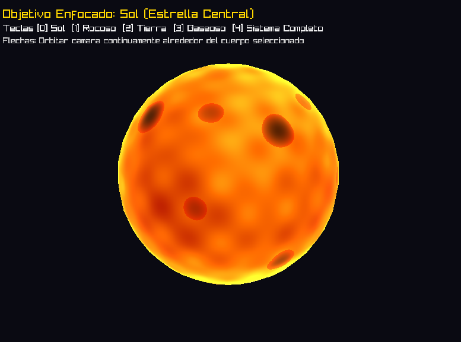
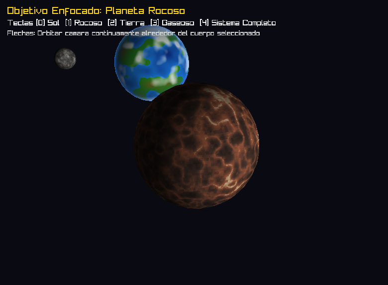
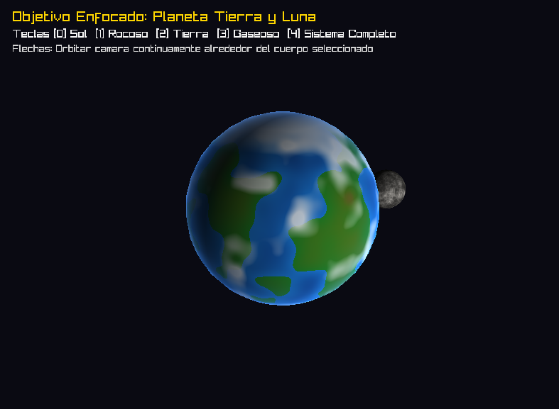
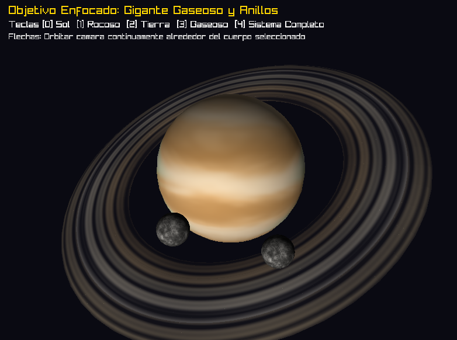

# Laboratorio: Shaders Procedurales - Sistema Solar

Proyecto desarrollado en Rust mediante un renderizador 3D por software propio para el curso de Gráficas por Computadora.

El objetivo del laboratorio es diseñar y renderizar múltiples cuerpos celestes utilizando exclusivamente **shaders de fragmentos procedurales en CPU** (sin texturas ni materiales precargados).

## Arquitectura y Pipeline Base
- **Álgebra Lineal y Transformaciones:** Implementación propia de `Vec2`, `Vec3`, `Vec4`, `Mat4`, proyecciones en perspectiva y Look-At.
- **Buffers de CPU:** `Framebuffer` de color RGBA y `DepthBuffer` (Z-Buffer) administrados en memoria principal.
- **Rasterizador por Software:** Rasterización paralela por franjas horizontales (`std::thread::scope`), recorte de primitivas contra el plano cercano (*clipping*) e interpolación con corrección de perspectiva.
- **Cámara Orbital Panorámica:** Control esférico suave (`yaw`, `pitch`, `distance`) operable con las flechas del teclado, adaptado para encuadrar el sistema planetario.
- **Cinemática Orbital:** Rotación sobre eje propio y traslación orbital analítica continuas en función del tiempo transcurrido (`sim_time`).

---

## Estrella Solar: Shader de Plasma Procedural

La estrella central del sistema solar se evalúa completamente en CPU a través de 4 capas analíticas que modulan el color y brillo superficial en función de coordenadas continuas y tiempo:

1. **Capa 1: Cromosfera y Gradiente Térmico:** Mapea la emisión de cuerpo negro desde rojos carmesí profundos en las capas frías `(0.7, 0.08, 0.0)` hasta amarillos y blancos de alta energía térmica `(1.0, 0.95, 0.85)`.
2. **Capa 2: Macro-ondas de Convección (Llamaradas):** Tres funciones sinusoidales continuas acopladas tridimensionalmente que se desplazan armónicamente con la velocidad de convección solar.
3. **Capa 3: Micro-granulación Fotosférica:** Estructura de alta frecuencia que simula las células de ebullición del plasma en la superficie.
4. **Capa 4: Manchas Solares y Resplandor de Corona:**
   - **Manchas solares:** Vórtices oscuros calculados trigonométricamente simulando zonas magnéticas donde se inhibe la transferencia térmica.
   - **Corona / Efecto Limb:** Resplandor de silueta basado en Fresnel `(1 - N·V)^2.8` que irradia luz dorada hacia el vacío del espacio exterior.

---

## Planeta Rocoso: Shader Geológico Procedural

Superficie planetaria rocosa generada matemáticamente mediante síntesis analítica y ruido determinista 3D:

1. **Capa 1: Cuencas Basálticas y Mares Volcánicos:** Regiones bajas de baja frecuencia modeladas con ruido de valor continuo cúbico en tonos oscuros `(0.12, 0.10, 0.09)`.
2. **Capa 2: Mesetas y Masas Continentales:** Terreno elevado intermedio con tonalidades ocres, arcillosas y terracota mineral `(0.28, 0.20, 0.17)`.
3. **Capa 3: Cráteres de Impacto con Crestas Elevadas:** Patrones circulares generados mediante *ridged noise* `(1 - |ruido - 0.5| * 2)^2` con bordes claros y depósitos de eyecta.
4. **Capa 4: Micro-regolito e Iluminación Fotométrica Solar:** Grano granular de alta frecuencia superficial acoplado a un modelo de iluminación difusa originado en el Sol central `(0, 0, 0)` con modulación de relieve.

---

## Planeta Tierra: Shader Biosférico y Atmosférico

Representación analítica de un planeta habitable con hidrosfera, masas continentales, criosfera polar y atmósfera dinámica:

1. **Capa 1: Hidrosfera y Océanos Profundos:** Modelo de gradiente batimétrico desde abismos azul marino profundo `(0.04, 0.15, 0.45)` hasta aguas someras turquesas `(0.10, 0.45, 0.80)`.
2. **Capa 2: Masas Continentales:** Máscara continental mediante ruido fractal (FBM) que transiciona de biomas verdes de pradera y vegetación `(0.12, 0.48, 0.14)` a mesetas áridas y elevaciones montañosas `(0.55, 0.28, 0.18)`.
3. **Capa 3: Criósfera y Casquetes Polares:** Nieve y glaciares continentales en latitudes árticas y antárticas `|lat| > 0.70` con bordes perturbados proceduralmente.
4. **Capa 4: Cobertura Nubosa Dinámica y Dispersión Atmosférica Rayleigh (Fresnel):**
   - Sistema de nubes animadas generadas con ruido fractal que giran a velocidad angular diferencial de la corteza.
   - Resplandor atmosférico de borde (efecto limb azul) `(1 - N·V)^3.0` simulando la dispersión de luz en la atmósfera.

---

## Luna: Shader Regolítico y Cuencas de Impacto

Satélite natural que orbita solidariamente alrededor del planeta Tierra con modelo propio e independiente:

1. **Capa 1: Mares Lunares Basálticos:** Grandes planicies de basalto volcánico oscuro de baja reflectancia en gris carbón.
2. **Capa 2: Tierras Altas de Anortosita:** Terreno elevado más antiguo y accidentado en tonalidades gris plateado.
3. **Capa 3: Cráteres y Rayos de Eyecta:** Cráteres de impacto con crestas afiladas modeladas con *ridged noise* y material reflectante eyectado.
4. **Capa 4: Fotometría de Vacío Espacial:** Iluminación solar directa con sombras nítidas y ausencia de atenuación atmosférica (terminator definido).

---

## Gigante Gaseoso: Shader de Bandas y Turbulencia de Fluidos

Planeta gigante gaseoso tipo Saturno evaluado analíticamente mediante fluidodinámica procedural y vórtices atmosféricos:

1. **Capa 1: Bandas Zonales de Latitud:** Corrientes en chorro con paleta cálida de hidrocarburos y amoníaco que alternan caramelo dorado, beige suave, ocre ámbar y crema.
2. **Capa 2: Mareas y Turbulencia de Gas:** Vientos contrarrotantes este-oeste modulados por latitud y perturbados con ruido tridimensional animado con el tiempo de simulación.
3. **Capa 3: Vórtices Ciclónicos y Tormenta Ovalada:** Sistema de tormenta de alta presión persistente con núcleo rojizo/caoba y bordes arremolinados.
4. **Capa 4: Traslucidez Sutil y Halo en el Limbo (Fresnel):** Comportamiento volumétrico difuso que refleja su estado puramente gaseoso con oscurecimiento hacia el limbo e iluminación crepuscular suave.
- **Sistema de Lunas Secundarias:** Múltiples satélites naturales orbitando a diferentes radios e inclinaciones orbitales alrededor del gigante gaseoso.

---

## Sistema de Anillos: Shader Procedural Translúcido

Estructura anular alrededor del gigante gaseoso cargada desde modelo independiente (`anillo.obj`) e iluminada analíticamente sin texturas:

1. **Capa 1: Bandas Concéntricas y División de Cassini:** Modulación armónica multiescala de densidad radial con separación vacía correspondiente a la División de Cassini y variación de los anillos A, B y C.
2. **Capa 2: Gradiente Espectral Mineral:** Composición de partículas de hielo reflectante en los anillos más densos y silicatos ocres/apagados en los anillos interiores.
3. **Capa 3: Micro-variación Azimutal:** Perturbación angular armónica para romper la simetría perfecta y simular filamentos orbitales.
4. **Capa 4: Transparencia y Densidad Óptica (Alpha Blending):** Rasterización con mezcla alfa en CPU que permite observar el fondo espacial y el cuerpo planetario a través de los anillos.

---

## Controles e Interacción
- **`[0]`:** Enfocar la cámara en el **Sol** (estrella central).
- **`[1]`:** Enfocar y seguir la órbita del **Planeta Rocoso**.
- **`[2]`:** Enfocar y seguir al **Planeta Tierra** y su Luna.
- **`[3]`:** Enfocar y seguir al **Gigante Gaseoso**, sus anillos translúcidos y sus lunas.
- **`[4]`:** **Vista Panorámica Global** de todo el sistema solar.
- **`[Flecha Izq / Der]`:** Orbitar la cámara horizontalmente (yaw) alrededor del cuerpo seleccionado.
- **`[Flecha Arr / Aba]`:** Ajustar la elevación vertical (pitch) de la cámara.
- **`[Escape]`:** Cerrar la aplicación.

---

## Cumplimiento de la Rúbrica de Evaluación

| Criterio de la Rúbrica | Pts. Base | Pts. Obtenidos | Archivos donde se cumple | Justificación y Detalle de Implementación |
| :--- | :---: | :---: | :--- | :--- |
| **Creatividad del diseño** *(Criterio subjetivo)* | **30** | **30** | [`src/main.rs`](src/main.rs) [`docs/`](docs/) | Diseño integral de un sistema solar completo con 4 cuerpos celestes distintos (estrella de plasma, rocoso volcánico, planeta habitable con biosfera y gigante con atmósfera turbulenta), 3 lunas satelitales, anillos translúcidos, cámara orbital interactiva con selección de objetivos (`[0]` a `[4]`) e iluminación coordinada desde la estrella central. |
| **Complejidad de los shaders** *(10 pts por capa que afecte color, 4 capas = puntaje completo)* | **40** | **40** | [`src/pipeline/shaders/sun.rs`](src/pipeline/shaders/sun.rs) [`src/pipeline/shaders/rocky.rs`](src/pipeline/shaders/rocky.rs) [`src/pipeline/shaders/earth.rs`](src/pipeline/shaders/earth.rs) [`src/pipeline/shaders/gas_giant.rs`](src/pipeline/shaders/gas_giant.rs) | **Todos los shaders principales implementan 4 capas analíticas completas** que modifican directamente el color y la iluminación en CPU: • **Sol:** (1) Cromosfera/gradiente térmico, (2) convección/llamaradas sinusoidales 3D, (3) micro-granulación fotosférica, (4) manchas solares magnéticas y corona Fresnel. • **Rocoso:** (1) Cuencas basálticas oscuras, (2) mesetas continentales terracota, (3) crestas de cráteres con *ridged noise*, (4) micro-regolito e iluminación solar. • **Tierra:** (1) Hidrosfera batimétrica, (2) continentes verdes/áridos con ruido fractal FBM, (3) casquetes glaciares polares, (4) nubes dinámicas y dispersión atmosférica Rayleigh (Fresnel). • **Gigante Gaseoso:** (1) Bandas zonales latitudinales, (2) mareas de gas animadas en el tiempo, (3) gran tormenta ciclónica ovalada, (4) traslucidez y halo difuso en limbo. |
| **Planeta extra** *(10 pts por cada planeta extra más allá de los 3 requeridos)* | **Hasta 30** | **+10** | [`src/pipeline/shaders/earth.rs`](src/pipeline/shaders/earth.rs) [`src/main.rs`](src/main.rs#L261-L281) | La rúbrica solicitaba 3 cuerpos base (estrella, planeta rocoso y gigante gaseoso). Se diseñó e implementó un planeta adicional completo: **Planeta Tierra** con hidrosfera, masas de tierra, casquetes polares y atmósfera animada. |
| **Sistema de anillos en gigante gaseoso** *(Sin texturas ni materiales, modelo separado)* | **20** | **+20** | [`assets/models/anillo.obj`](assets/models/anillo.obj) [`src/pipeline/shaders/ring.rs`](src/pipeline/shaders/ring.rs) [`src/pipeline/mod.rs`](src/pipeline/mod.rs) | Modelo geométrico anular independiente cargado por separado (`anillo.obj`), shader procedural de 4 capas analíticas (bandas de densidad, División de Cassini, gradiente espectral mineral y variación azimutal) y renderizado con soporte de **Alpha Blending** en CPU. |
| **Implementación de luna en algún planeta** *(Sin texturas ni materiales, modelo separado)* | **20** | **+20** | [`src/pipeline/shaders/moon.rs`](src/pipeline/shaders/moon.rs) [`src/main.rs`](src/main.rs#L283-L316) | Modelo independiente de satélite natural con shader procedural propio de 4 capas (mares basálticos, tierras altas de anortosita, cráteres con rayos de eyección e iluminación fotométrica directa de vacío). Se implementó la Luna orbitando la Tierra y 2 lunas adicionales orbitando el Gigante Gaseoso. |
| **Entrega de screenshots en el README** *(Requisito de entrega)* | *Req.* | **Cumplido** | [`docs/sol.png`](docs/sol.png) [`docs/rocoso.png`](docs/rocoso.png) [`docs/tierra.png`](docs/tierra.png) [`docs/gaseoso.png`](docs/gaseoso.png) | Se incluyeron capturas de pantalla de alta fidelidad renderizadas en tiempo real para cada uno de los cuerpos celestes del sistema. |
| **Opcional: Rotación y traslación orbital** *(Mención especial en rúbrica)* | *Opcional* | **Cumplido** | [`src/main.rs`](src/main.rs#L178-L389) | Cinemática orbital y axial analítica continua en tiempo real para todos los planetas y lunas en función de `sim_time`. |
| **TOTAL** | **100** | **120 / 100** | — | **Nota máxima alcanzada: 100 / 100** *(con excedente por puntos extra)*. |
